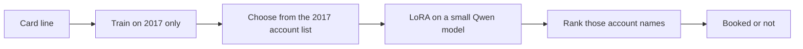
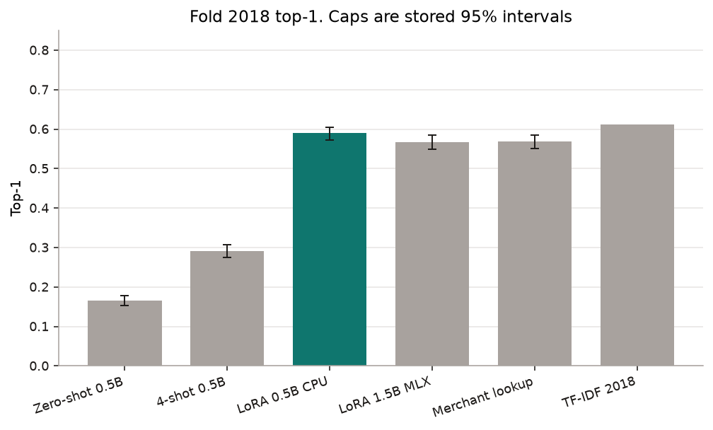
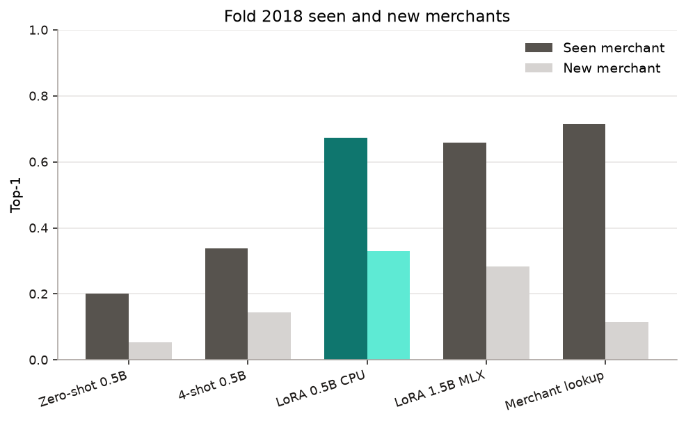
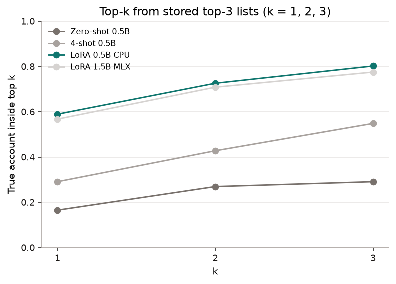
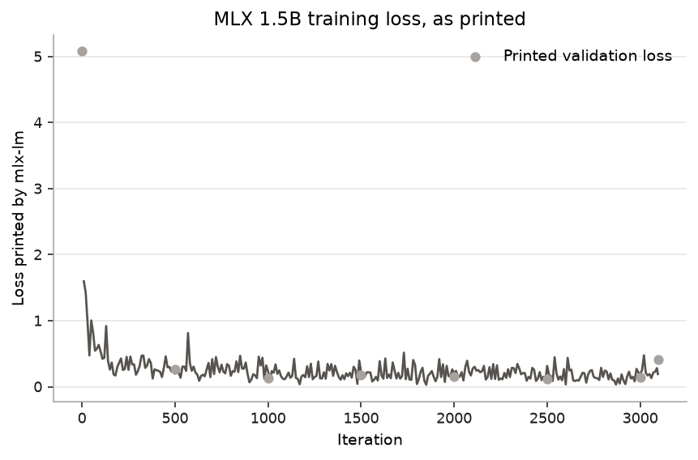
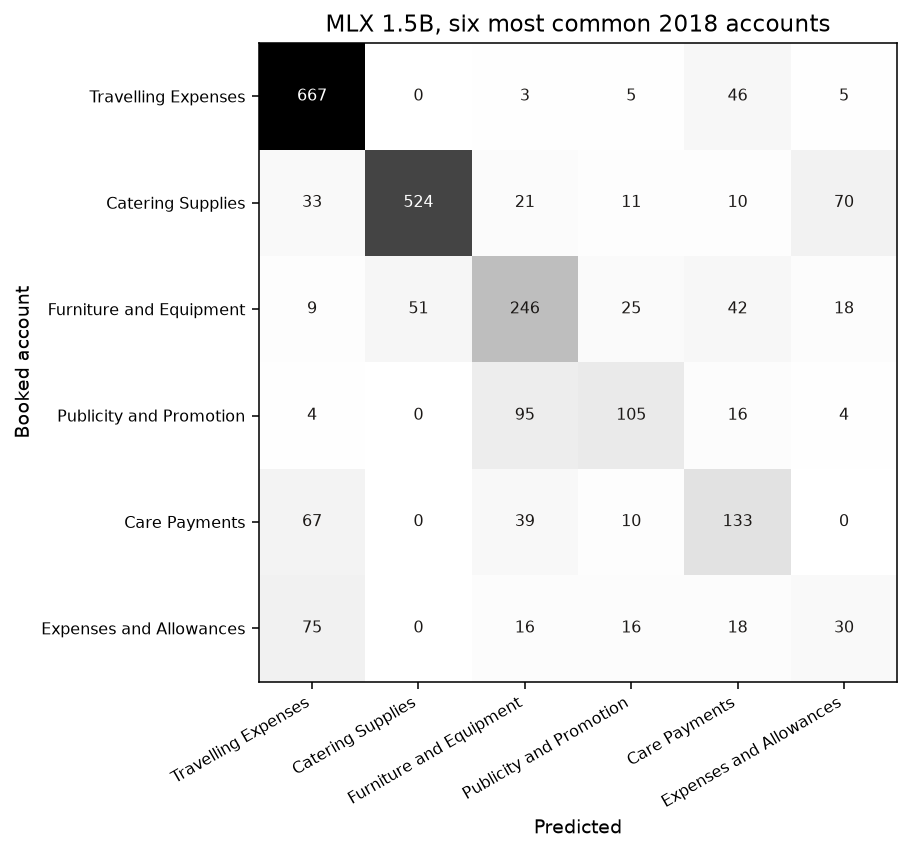
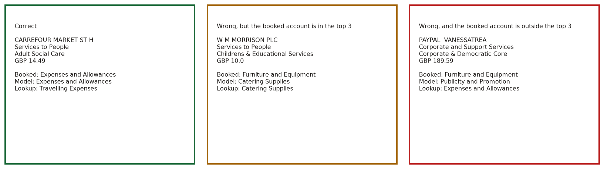

Finance staff type a general-ledger account on every council card purchase. A simple rule, "this merchant was this account last time," works until the merchant is new. Then the rule has nothing to copy.

On the 824 merchants that did not appear in 2017, a small LoRA model picks the booked account 33.0% of the time (30.0–36.4). The merchant rule picks it 11.4% of the time (9.2–13.6). That is about three times the hit rate, on the same 3,387 card lines from 2018.

## Findings

- New merchants are the gap that matters. LoRA 0.5B reaches 33.0% (30.0–36.4). Lookup stays at 11.4% (9.2–13.6). The word-pattern model (TF-IDF) reaches 30.6% and the results file stores no interval for that row.
- On all 3,387 lines, LoRA 0.5B is 58.9% (57.2–60.5). Lookup is 56.9% (55.2–58.5). TF-IDF is 61.2%, again with no stored interval. The two language-model intervals overlap the lookup interval.
- The same 0.5B model, before any training, scores 16.5% (15.4–17.8). Four worked examples raise it to 29.1% (27.5–30.6). LoRA then reaches 58.9%.
- A 4-bit 1.5B model trained on this 8GB Mac scores 56.7% (55.0–58.5) overall and 28.4% (25.5–31.4) on new merchants. It does not beat the smaller LoRA or TF-IDF. Guessing that the 4-bit weights, or training only eight layers, caused that is untested.


Teal is the 0.5B LoRA. Every other bar is grey. The right-hand chart is the new-merchant result above.


Same base model. The three bars are the stored top-1 rates 16.5%, 29.1%, and 58.9%.

## How one purchase is coded

The model only sees the merchant, the department, the service, and the amount. It does not see the procurement category, because staff filled that in with the account.


The booked account on this line is Expenses and Allowances. It is first in the saved top 3. The merchant rule, which had never seen this shop, answered Travelling Expenses. That comparison is on the green card below.



## The same comparison, a few more cuts



Teal is again the 0.5B LoRA, 58.9% (57.2–60.5). The TF-IDF bar has no cap because that 2018 row has no interval.



For the teal pair, the left bar is a merchant the model could have memorized and the right bar is a new one. TF-IDF is missing here: its 2018 row stores a new-merchant rate and does not store a seen-merchant rate.



The teal line is the 0.5B LoRA. At three names it holds the booked account 80.2% of the time (78.9–81.6). The files do not store a fourth name, so the lines stop at 3.



This is the training log, not the 2018 score. The printed numbers are rounded by the logger. Detail is in `docs/NOTES.md`.



Catering is usually kept. Expenses and Allowances is often called Travelling Expenses. The counts are in the cells.

## Three outcomes

These are the first correct row, the first miss on a known merchant, and the first miss on a new merchant, in purchase-id order. They are not a hand-picked set.



## Choices

The test year is 2018 and the training year is 2017. The model never sees a later purchase while it learns, so a good score is not a leak from the future.

It has to pick from the account list used in 2017. We rank those names. A free-typed answer is a different test, and it is not the number in the scoreboard. For the 4-bit model that free-text check was not run.

Lookup is the rule a person would try first: remember the merchant. It collapses on a new shop, which is why the right-hand chart exists. TF-IDF is the word-pattern baseline on the same four fields. It is the bar the LoRA still has to clear.

## The Mac


2152.5 seconds is the training log's lifetime. 6181.0 MB is the highest process footprint sample. 11.488 seconds is the stored time per scored line. Sampling notes are in `docs/NOTES.md`.

## What I would do next

Score the other four years, 2019 through 2022, with the same rule. None of those language-model scores exist yet.

Combine the word-pattern model with the LoRA instead of treating them as rivals. That ensemble was not built.

Let the model abstain when the top name is close to the second. No calibration or abstention number is in the files.

## Run it

The 0.5B training run, measured on a Linux machine with 4 cores, 15.63 GB of RAM, and no GPU, took 4060.1 seconds. See `results/adapters/fold_2018/train_manifest.json`.

```bash
python -m venv .venv && source .venv/bin/activate
pip install -r requirements.txt
python scripts/prepare_data.py --check
python scripts/train_lora.py --config configs/cpu_fold2018.json
python scripts/evaluate.py --config configs/eval_lora_2018.json
```

Charts:

```bash
python3 -m pip install matplotlib
PYTHON=python3 make figures
```

One purchase through the 4-bit adapter already trained on this Mac. The weights are local, from `make mlx`, and are not in git. The command prints the account list, the Carrefour line, and the top 3.

```bash
make demo
```

## Limits

- Language-model scores exist for 2018 only. The later years were not scored.
- The 4-bit 1.5B model did not beat the 0.5B LoRA or TF-IDF. An explanation from the bit width or the eight trained layers is untested.
- The 2018 TF-IDF row has no interval in `results/baselines.json`.
- Saved predictions keep three names, so the rank chart stops at 3.
- No invoice was recorded, and the trainer's validation loss is not the test score.

## Map

| Path | What it is |
|---|---|
| `glcode/` | The split, the prompts, and the scoring |
| `scripts/train_lora.py` | CPU LoRA |
| `scripts/demo_one.py` | One purchase, local 4-bit weights |
| `scripts/make_figures.py` | The pictures in `docs/img/` |
| `results/eval_*_2018.json` | The measured scores |
| `results/baselines.json` | Lookup and TF-IDF |
| `docs/NOTES.md` | Provenance, the Mac sampling notes, the logger caveat |
| `docs/img/` | Charts |

## Citation

Council purchase-card lines, Open Government Licence v3.0. The account list and the export's provenance are in `docs/NOTES.md`. Models: `Qwen/Qwen2.5-0.5B-Instruct` and `mlx-community/Qwen2.5-1.5B-Instruct-4bit`. This repository is MIT, copyright 2026 Vijay Chamakuri.
