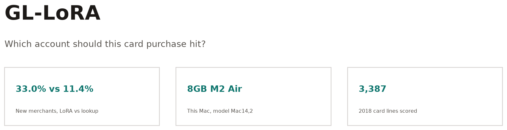
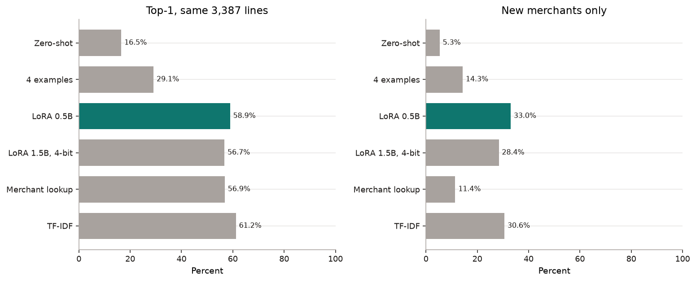
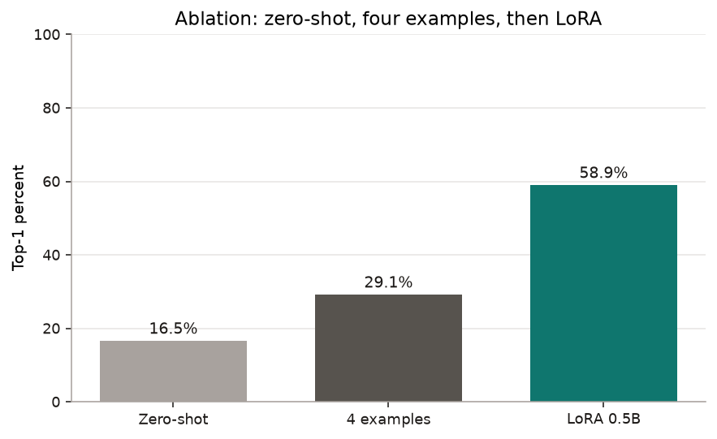
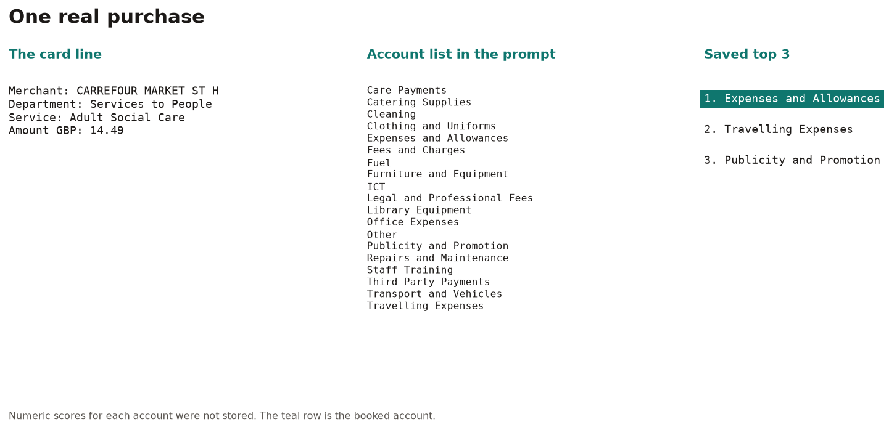
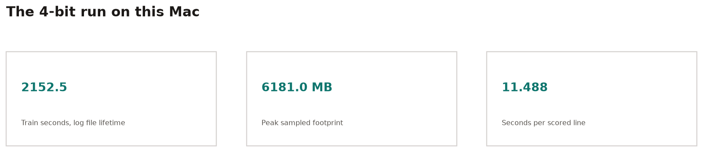

Finance staff type a general-ledger account on every council card purchase. A rule that copies the last account for that merchant works until the merchant is new. Then the rule has nothing to copy.

On the 824 merchants that did not appear in 2017, LoRA 0.5B picks the booked account 33.0% of the time (30.0–36.4). Merchant lookup picks it 11.4% of the time (9.2–13.6). Both rates are on the same 3,387 card lines from 2018.

## Findings

- New merchants: LoRA 0.5B is 33.0% (30.0–36.4). Lookup is 11.4% (9.2–13.6). TF-IDF is 30.6%.
- All 3,387 lines: LoRA 0.5B is 58.9% (57.2–60.5). Lookup is 56.9% (55.2–58.5). TF-IDF is 61.2%.
- The 4-bit 1.5B model is 56.7% (55.0–58.5) overall and 28.4% (25.5–31.4) on new merchants. It does not beat the 0.5B LoRA or TF-IDF.



## Ablation

Same 0.5B model, three setups. Zero-shot is 16.5% (15.4–17.8). Four examples is 29.1% (27.5–30.6). LoRA is 58.9% (57.2–60.5).



## One purchase

The model sees the merchant, the department, the service, and the amount. It does not see the procurement category. Staff filled that in with the account.



The booked account is Expenses and Allowances. Lookup, which had never seen this shop, answered Travelling Expenses.

`make demo` on the committed 0.5B adapter prints:

```
booked: Expenses and Allowances
top3: Expenses and Allowances | Travelling Expenses | Fees and Charges
```

The diagram above is the stored 4-bit top 3 for the same line. Third place there is Publicity and Promotion. The three outcome cards are in [docs/charts.md](docs/charts.md).

## How it works

The scorer does not let the model type a free answer. It ranks the 19 accounts from the 2017 list (`n_candidates` in [results/eval_qwen05_lora_2018.json](results/eval_qwen05_lora_2018.json)). For each name it takes the mean token log-probability of that name as the reply. The highest mean wins.

[glcode/score.py](glcode/score.py) builds one prompt, then the tokens for each account name. It sums the log-prob of those answer tokens and divides by the token count. A sum would favour a short name such as ICT over Legal and Professional Fees, so the mean is the rank. [glcode/metrics.py](glcode/metrics.py) sorts those means and keeps the top name. The mean was chosen before any language-model result was measured.

```python
prompt, first_comp = split_prompt_completion(tokenizer, user, labels[0])
comps = [first_comp]
for label in labels[1:]:
    prompt_i, comp = split_prompt_completion(tokenizer, user, label)
    if prompt_i != prompt:
        raise RuntimeError("prompt tokens changed across labels; the account list must stay fixed")
    comps.append(comp)
...
first = torch.log_softmax(out.logits[0, -1].float(), dim=-1)
sums = torch.tensor([first[comp[0]].item() for comp in comps], dtype=torch.float64)
counts = torch.ones(len(comps), dtype=torch.float64)
...
for i, comp in enumerate(comps):
    for t in range(1, len(comp)):
        sums[i] += logp[i, t - 1, comp[t]].item()
        counts[i] += 1
means = sums / counts
return sums.tolist(), means.tolist()
```

## LoRA and QLoRA

| | LoRA | QLoRA |
|---|---|---|
| Config | [configs/cpu_fold2018.json](configs/cpu_fold2018.json) | [configs/mlx_m2_8gb.yaml](configs/mlx_m2_8gb.yaml) |
| Base | `Qwen/Qwen2.5-0.5B-Instruct` | `mlx-community/Qwen2.5-1.5B-Instruct-4bit` |
| Precision | float32, `qlora: no` | 4-bit base plus LoRA |
| Adapter | r 16, alpha 32, dropout 0.05, `all-linear` | rank 8, scale 20, dropout 0, attention q/k/v/o, 8 layers |
| Length and batch | 512 tokens, batch 1, grad accum 8, checkpoint off | 256 tokens, batch 1, grad checkpoint on |
| Learning rate | 0.0002 | 1.0e-4 |

Float32 is there because bf16 did not match a full-sequence forward to about 1e-4. That note is in [glcode/score.py](glcode/score.py).

The 8 layers, attention-only targets, sequence length 256, batch size 1, and gradient checkpointing are the memory-safe defaults for an 8GB M2 MacBook Air in [configs/mlx_m2_8gb.yaml](configs/mlx_m2_8gb.yaml). If the 1.5B model runs out of memory, [scripts/run_mlx.sh](scripts/run_mlx.sh) falls back to the 0.5B 4-bit model.

## Evaluation

Training lines are 2017. The test is the 3,387 labelled lines from 2018. The prompt drops merchant category, because staff assigned that field with the label. [glcode/prompts.py](glcode/prompts.py) records that choice.

The intervals are bootstrap 95% CIs from [glcode/metrics.py](glcode/metrics.py): 2,000 resamples, seed 0, percentiles 2.5 and 97.5.

## Limitations

- Language-model scores exist for 2018 only.
- The 2018 TF-IDF row in [results/baselines.json](results/baselines.json) has no interval.
- On all lines, the 0.5B LoRA interval overlaps the lookup interval.
- Whether 4-bit weights or the eight trained layers explain the 1.5B result was not tested.
- Saved predictions keep three names, so the rank chart stops at 3.

Longer notes, including the exact Mac samples, are in [docs/NOTES.md](docs/NOTES.md).

## Fitting a 1.5B model in 8GB

The machine has 8GB of unified memory. [configs/mlx_m2_8gb.yaml](configs/mlx_m2_8gb.yaml) keeps the 4-bit 1.5B run inside that limit: batch size 1, sequence length 256, LoRA on the last 8 attention projections, and gradient checkpointing. If that still runs out of memory, [scripts/run_mlx.sh](scripts/run_mlx.sh) falls back to the 0.5B 4-bit model.



Training took ~36 min. Peak sampled footprint was 6.2 GB. Scoring took 11.5 s per line. The unrounded log figures are in [docs/NOTES.md](docs/NOTES.md).

## What I learned

- Lookup has nothing to copy for a new merchant. That gap is 11.4% versus 33.0% for the 0.5B LoRA.
- Four examples move the same base model from 16.5% to 29.1%. The adapter reaches 58.9%.
- TF-IDF still leads on the full year, at 61.2%.
- A larger 4-bit model on this Mac did not beat the smaller float32 LoRA.

## What I would do next

- Score 2019-2022 as additional yearly folds.
- Ensemble TF-IDF with the LoRA scores.
- Add abstention when the top two candidates are close, and measure calibration.

## Run it

`make test` runs pytest. The six files are [tests/test_baselines_published.py](tests/test_baselines_published.py), [tests/test_mlx_export.py](tests/test_mlx_export.py), [tests/test_parse.py](tests/test_parse.py), [tests/test_prompts_and_metrics.py](tests/test_prompts_and_metrics.py), [tests/test_reference_and_split.py](tests/test_reference_and_split.py), and [tests/test_score_fp32.py](tests/test_score_fp32.py).

The 0.5B training run, on a Linux machine with 4 cores, about 16 GB of RAM, and no GPU, took about 68 min. The exact fields are in [results/adapters/fold_2018/train_manifest.json](results/adapters/fold_2018/train_manifest.json).

```bash
python -m venv .venv && source .venv/bin/activate
pip install -r requirements.txt
python scripts/prepare_data.py --check
make test
make demo
```

`make demo` scores one committed-adapter purchase, card line `2018-01_f41af6e3.csv:10`. It prints the account list and the top 3. The weights are [results/adapters/fold_2018](results/adapters/fold_2018).

The 4-bit weights are not in git. Run `make mlx` before using that path.

Charts:

```bash
python3 -m pip install matplotlib
PYTHON=python3 make figures
```

## Map

| Path | What it is |
|---|---|
| [glcode/score.py](glcode/score.py) | Mean-token ranking |
| [glcode/metrics.py](glcode/metrics.py) | Bootstrap intervals |
| [glcode/prompts.py](glcode/prompts.py) | Prompt, merchant category left out |
| [glcode/train.py](glcode/train.py) | CPU LoRA training |
| [glcode/evaluate.py](glcode/evaluate.py) | CPU scoring |
| [glcode/mlx_data.py](glcode/mlx_data.py) | 8GB QLoRA export and config |
| [glcode/mlx_eval.py](glcode/mlx_eval.py) | 4-bit scoring |
| [scripts/train_lora.py](scripts/train_lora.py) | CPU train entry point |
| [scripts/demo_one.py](scripts/demo_one.py) | One purchase, committed 0.5B adapter |
| [scripts/make_figures.py](scripts/make_figures.py) | Charts in [docs/img/](docs/img) |
| [configs/cpu_fold2018.json](configs/cpu_fold2018.json) | 0.5B LoRA config |
| [configs/mlx_m2_8gb.yaml](configs/mlx_m2_8gb.yaml) | 1.5B QLoRA config |
| [results/eval_qwen05_lora_2018.json](results/eval_qwen05_lora_2018.json) | 0.5B LoRA scores |
| [results/eval_mlx_2018.json](results/eval_mlx_2018.json) | 4-bit scores |
| [results/baselines.json](results/baselines.json) | Lookup and TF-IDF |
| [docs/NOTES.md](docs/NOTES.md) | Provenance, sampling, hedges |
| [docs/charts.md](docs/charts.md) | The other charts |
| [tests/](tests) | The pytest suite |

## Citation

Council purchase-card lines, Open Government Licence v3.0. Provenance is in [docs/NOTES.md](docs/NOTES.md). Models: `Qwen/Qwen2.5-0.5B-Instruct` and `mlx-community/Qwen2.5-1.5B-Instruct-4bit`. This repository is MIT, copyright 2026 Vijay Chamakuri.
