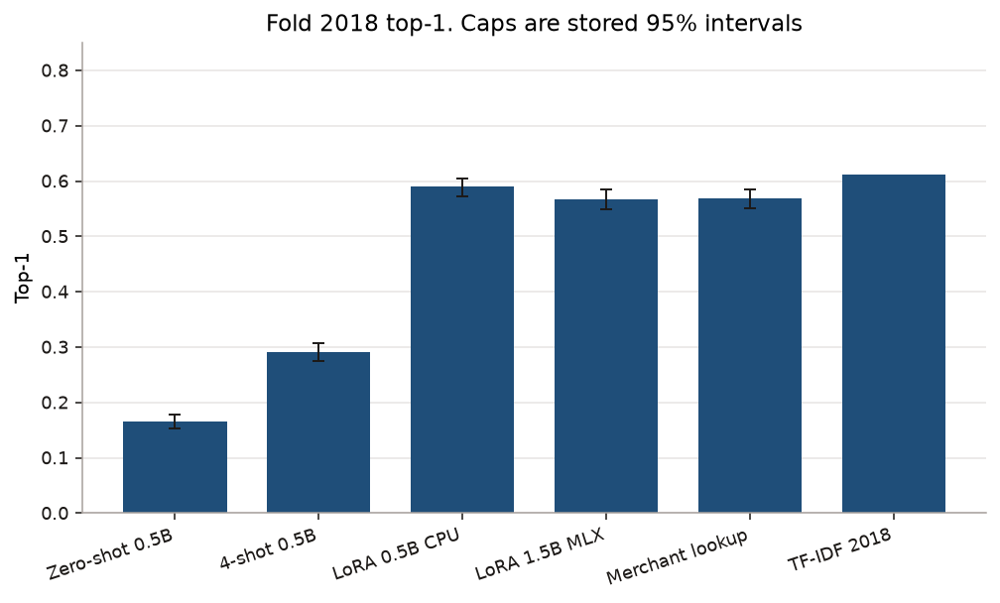
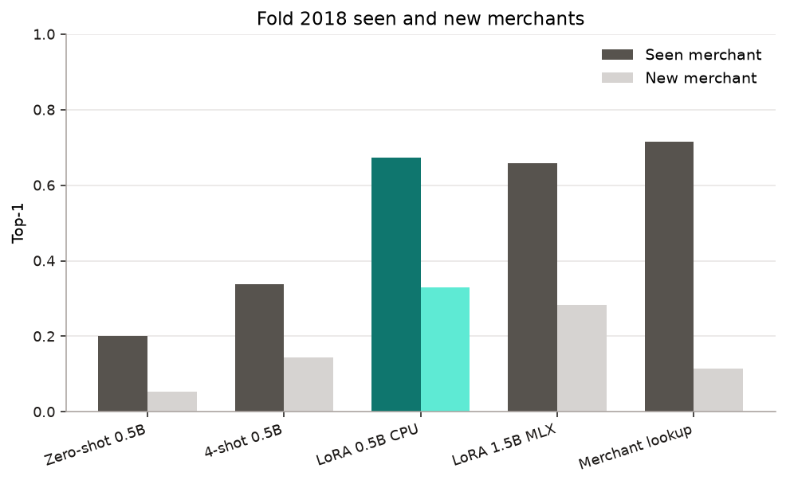
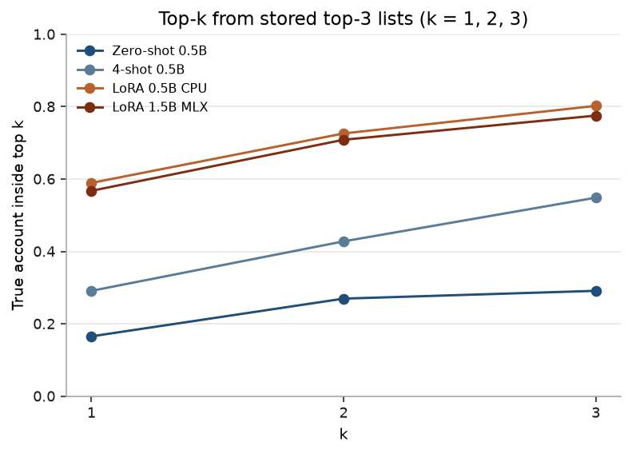
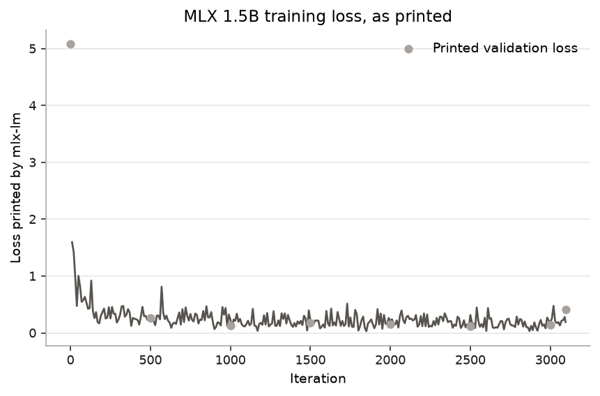
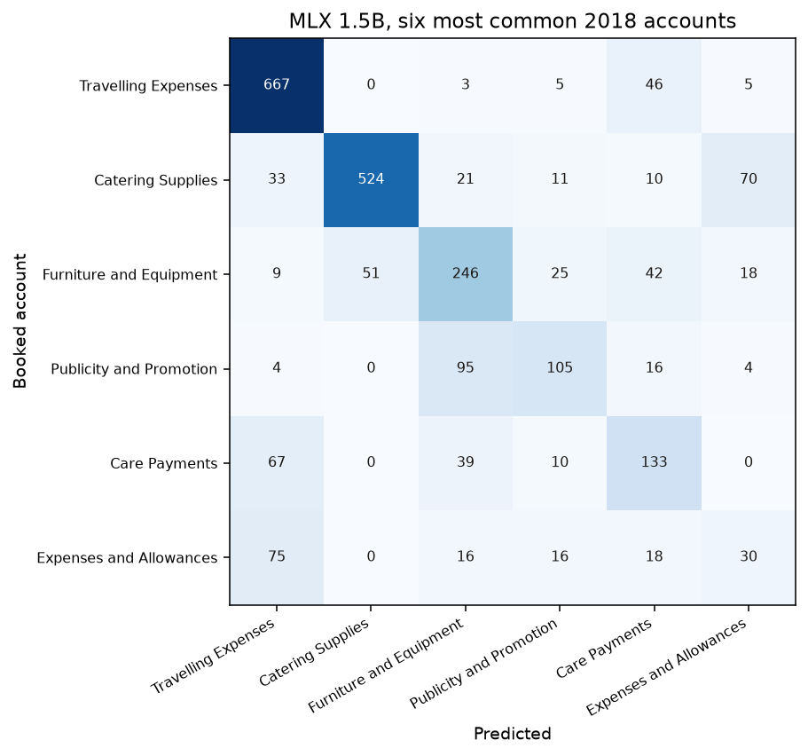
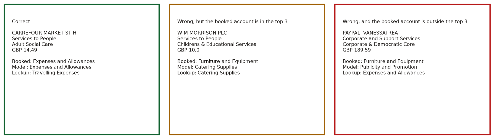

# Other charts

The scoreboard, the ablation, and the one-purchase diagram stay in the [README](../README.md). These are the rest. Teal is the 0.5B LoRA. Other methods are grey.

LoRA 0.5B is 58.9% (57.2–60.5). The TF-IDF bar has no cap. That 2018 row has no interval.

For the teal pair, the left bar is a merchant in the 2017 data and the right bar is a new one. TF-IDF is missing. Its 2018 row stores a new-merchant rate and does not store a seen-merchant rate.

At three names the 0.5B LoRA holds the booked account 80.2% of the time (78.9–81.6). The files do not store a fourth name, so the lines stop at 3.

This is the training log, not the 2018 score. The printed numbers are rounded by the logger. Detail is in [NOTES.md](NOTES.md).

Catering is usually kept. Expenses and Allowances is often called Travelling Expenses. The counts are in the cells.

These are the first correct row, the first miss on a known merchant, and the first miss on a new merchant, in purchase-id order.
